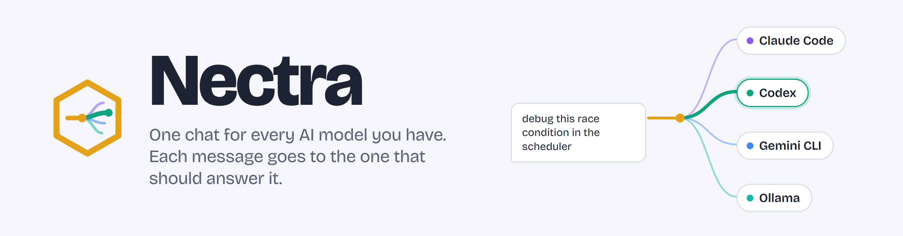
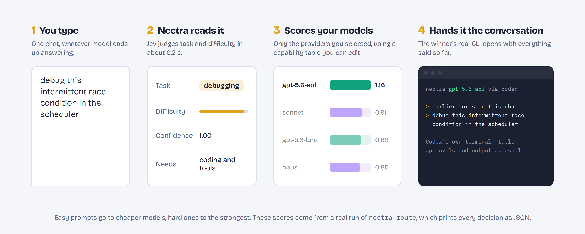

<p>
<picture>
  <source media="(prefers-color-scheme: dark)" srcset="docs/brand/banner-dark.png">
  
</picture>
</p>

<div align="center">

[](https://github.com/MBarc/nectra/actions/workflows/ci.yml)
[](LICENSE)
[](Cargo.toml)
[](#which-platforms)

**[Install](#install)** &nbsp;&nbsp; **[For AI agents](#for-ai-agents)** &nbsp;&nbsp; **[FAQ](#faq)** &nbsp;&nbsp; **[Full reference](docs/reference.md)**

</div>

You've got Claude Code, Codex, Gemini CLI and maybe a model or two running in
Ollama. Each is better at something, and each costs something different. So you
keep three terminals open, paste context between them by hand, and send a
"thanks!" to your most expensive model because it happened to be the window in
front of you.

Nectra gives you one chat. It reads each message, picks the model that should
answer it, hands that model the conversation so far, and opens that provider's
real terminal. When the answer lands, you're back at one prompt for the next
message.

## Each message goes to the right model

<p>
<picture>
  <source media="(prefers-color-scheme: dark)" srcset="docs/brand/how-it-works-dark.png">
  
</picture>
</p>

Nectra works out what kind of task a message is (debugging, writing, planning,
code review and six more) and how much model it needs. Then it scores every
model you've enabled and opens the winner. You can always see why:

```sh
nectra route "debug this intermittent race condition in the scheduler"
```

```json
{
  "task": "debugging",
  "model": "gpt-5.6-sol",
  "runtime": "codex",
  "score": 1.1582785,
  "score_margin": 0.24934578,
  "ambiguous": false,
  "reason": "jev classified prompt as debugging (confidence 1.00, difficulty 0.93 -> Demanding); highest eligible score including task responsibility and complexity",
  "candidates": [
    { "model": "gpt-5.6-sol",  "score": 1.1582785 },
    { "model": "sonnet",       "score": 0.9089327 },
    { "model": "gpt-5.6-luna", "score": 0.8883139 },
    { "model": "opus",         "score": 0.85114044 }
  ]
}
```

<sub>Abbreviated. The full output also carries the provider, effort, mode and override flags.</sub>

Don't agree? `/model sonnet` in the chat, or `--model` on the command line, and
the conversation carries on.

## Easy prompts go to cheaper models

A quick question doesn't need your strongest model, and an architecture question
shouldn't get your weakest. Nectra asks [Jev](https://docs.typesafe.ai),
TypeSafe's hosted classifier, to judge each message in one call of about 0.2
seconds: what kind of task it is, whether it continues the last one, and which
kind of model should take it. Jev only chooses among the kinds your models
actually cover (`prefers = ["simple"]`, `["coding"]`, `["planning"]` and so on in
`models.toml`), so adding a cheap model to your registry is what lets easy
messages reach it.

The built-in keyword matcher is tuned to the examples it was built from. On
phrasing it hasn't seen, Jev picks the right task type far more often:

| Prompt set | Keywords | Jev |
|---|---|---|
| Tuned examples ([`eval/tasks.json`](eval/tasks.json)) | 38 of 38 | 37 of 38 |
| Unseen phrasing ([`eval/generalization.json`](eval/generalization.json)) | 10 of 20 | 17 of 20 |
| Fresh holdout ([`eval/holdout.json`](eval/holdout.json)) | 13 of 40 | 39 of 40 |

Jev is optional. Without a key, offline, or if it doesn't answer in time, Nectra
falls back to its keyword matcher and nothing leaves your machine. Every
decision's `reason` says which one decided.

## One task stays on one model

Switching models in the middle of a task is expensive: the new agent starts cold,
re-reads the files the last one already read, and none of the provider's prompt
cache carries over. So Nectra routes per task, not per message:

- **Follow-ups stay put.** "Now add a test for it" or "commit it" goes to the model
  already doing the work. Jev decides whether a message continues the task or
  starts a new one (10 of 10 right on our hand-written pairs; without Jev, a
  keyword check does it).
- **The same model picks up where it left off.** Claude Code and Codex resume their
  own session, so a follow-up sends only your new message, not the whole
  conversation again. The agent still has every file it read and command it ran.
- **A real switch gets a handoff note.** If you move a running task to another
  model with `/model`, the outgoing model writes a short note (goal, files touched,
  decisions, next step) and the new one gets that plus the latest turns, instead of
  a full transcript replay.
- **New tasks route fresh.** A new task can go to a different model, with the
  conversation so far as context.

Each of these can be switched off in `[routing]`: `sticky`, `resume_sessions`,
`handoff_summary`.

## Expected savings

These are estimates from published prices, not measurements. Your own numbers
come from `nectra usage` (below). Nectra saves the most when your day mixes
heavy work with lots of quick, separate questions, because each quick one can go
to a cheap model instead of opening a new session on your most expensive one.

Example: one standalone quick question ("what's the flag to skip git hooks?") in
Claude Code. Every new Claude Code session first caches its own instructions,
about 36,000 tokens (we measured 35,868), at 1.25x the input price:

| Where it goes | Startup cache write | 300-token answer | About |
|---|---|---|---|
| Opus 5.5 ($4 in / $20 out) | $0.18 | $0.006 | **$0.19** |
| Sonnet 5.5 ($2 / $10) | $0.09 | $0.003 | **$0.09** |
| Haiku 5.5 ($0.10 / $0.50) | $0.0045 | $0.0002 | **$0.005** |

If Claude Code writes that cache for an hour rather than five minutes, the write
costs 2x instead of 1.25x and every row above rises by the same factor, so the
ratios hold. Jev adds about $0.00003 per message (around 630 input tokens at
$0.042 per million). Prices are Anthropic's list prices as of October 2026.

| Who you are | Where Nectra saves | Rough size |
|---|---|---|
| **One subscription, one strong model** (e.g. Claude Max, always Opus) | Quick standalone questions go to Sonnet or Haiku instead of opening Opus sessions. Long coding tasks stay on Opus. | Small to moderate. If a quarter of your messages are quick standalone ones, they cost roughly a twentieth to a half of what they did. Long tasks cost the same. Shows up as weekly-limit headroom, not dollars. |
| **Several subscriptions** (Claude + ChatGPT/Codex, maybe Gemini) | Work spreads across all your plans by fit, and a rate-limited one hands over to another. | The biggest win here is not hitting a weekly limit mid-task. Token savings are on top of that. |
| **Pay-as-you-go API keys** | Same routing, counted in dollars. | Per quick question, roughly $0.19 on Opus down to $0.005 on Haiku (table above). Multiply by how many you ask. |
| **Local models** (Ollama) | Easy questions go to a model on your own machine. | Those messages cost $0 in tokens. |
| **Light, mostly-chat users** | Little to route. | Close to nothing. Plain Claude Code or Codex is fine. |

What doesn't get cheaper: a long task on one model costs what it would without
Nectra, because it stays on that model with its cache intact. Moving a long task
from Opus to Sonnet saves less than half price suggests, because both read cached
tokens at $0.20 per million, and in long sessions those reads are most of the bill.

To measure yours: use your usual tool for a week, then Nectra for a week, and
compare `nectra usage --days 7` with your provider's usage page for the first week.

## The real CLIs, not imitations

Claude Code, Codex and Gemini CLI run in a real terminal (ConPTY on Windows), so
you get their actual interface: colors, tool output and approval prompts. Nectra
shows a compact activity view while they work. Press F2 to see the full terminal
and answer an approval.

## It keeps going when a provider hits a limit

If a provider rejects a message with a rate limit before any work has started,
Nectra notes the cooldown and skips that model until it's over, so the next
message doesn't walk into the same wall. In the stream view
(`--provider-view stream`) it also retries the message on another model you've
enabled. The terminal view can't prove no tools ran yet, so there it tells you
and lets you choose.

## Local models count too

Point Nectra at an Ollama server and its models compete on the same table as the
hosted ones. Choose `local-only` and nothing goes to a hosted provider, Jev
included.

## Install

Prebuilt for Windows (x64) and Linux (x64). On macOS, build from source (below)
until macOS releases are available. On Windows, in PowerShell:

```powershell
irm https://raw.githubusercontent.com/MBarc/nectra/master/scripts/install.ps1 | iex
```

On Linux:

```sh
curl -fsSL https://raw.githubusercontent.com/MBarc/nectra/master/scripts/install.sh | sh
```

The installer checks the download's SHA-256, puts `nectra` on your PATH and runs
`nectra setup`. Or grab the archive yourself from
[Releases](https://github.com/MBarc/nectra/releases).

To build from source instead, with current stable Rust:

```sh
git clone https://github.com/MBarc/nectra.git
cd nectra
cargo build --release --locked
./target/release/nectra setup
./target/release/nectra
```

`nectra setup` asks which providers you have and checks that their CLIs are
installed. Then it offers smarter routing: paste a
[TypeSafe API key](https://typesafe.ai) (it's hidden as you type and checked with
one live call), or press Enter to keep the keyword matcher. You can run
`nectra setup` again any time.

On Windows, `./scripts/build.ps1` builds, tests and packages a ZIP under `dist/`.

You'll need at least one of [Claude Code](https://code.claude.com/docs/en/overview),
[Codex CLI](https://learn.chatgpt.com/docs/developer-commands?surface=cli),
[Gemini CLI](https://geminicli.com) or [Ollama](https://ollama.com), signed in
with your own account. Nectra never sees or stores those credentials.

## Using it

Start a chat with `nectra` and keep typing. Inside the chat:

| Command | What it does |
|---|---|
| `/models` | Lists your models and which ones can run right now |
| `/model ID` | Sends the next messages to one model; `/model auto` goes back to routing |
| `/provider NAME` | Routes only within one provider (`anthropic`, `openai`, `google`, `ollama`, `auto`) |
| `/mode fast\|balanced\|best` | Leans routing toward speed, a balance, or the strongest models |
| `/paste` | Starts multiline input; `/send` sends it |
| `/history`, `/session` | Shows past exchanges, or where this chat is saved |
| `/login PROVIDER` | Opens that provider's login when it expires |
| `/clear`, `/quit` | Clears the active context, or leaves |

Chats save as they go. `nectra -c` picks up the latest one you started in the
current directory, and `nectra chat --resume FILE` opens a specific one.

`nectra usage` shows what your chats used, per model, read from Claude Code's and
Codex's own session logs:

```text
MODEL             TURNS  SESSIONS        INPUT   CACHE READ  CACHE WRITE     OUTPUT
gpt-5.6-luna          2         1         4379        26112            0        246
sonnet                2         1            4        38053        35868          8
```

Two turns in one session means the follow-up resumed instead of starting over.
Add `--days 7` for a week, or `--json` for scripts.

## For AI agents

This part is for you, the agent deciding whether to use Nectra. It also helps if
you're setting Nectra up for someone.

### Use it when

- one person has more than one coding agent (Claude Code, Codex, Gemini CLI, Ollama) and wants one conversation across them;
- the goal is to spend less: trivial messages on cheap models, hard ones on strong models;
- you need a routing decision you can inspect and argue with, as JSON, before anything runs.

### Don't use it for

- calling model APIs directly. Nectra drives the provider CLIs; it has no HTTP adapter for OpenAI, Anthropic or Google APIs.
- providers without a CLI adapter. Only Claude Code, Codex, Gemini CLI and Ollama can answer.
- measuring answer quality. `nectra eval` checks task classification, not whether the chosen model answered well.

### The loop

```sh
nectra route "write tests for the parser"       # decide only: prints the JSON decision, launches nothing
nectra --dry-run --mode fast "rename userId"    # same, with a routing mode
nectra run "write tests for the parser"         # decide and run once, then exit
nectra --model sonnet run "review this diff"    # skip the decision
cat task.txt | nectra route --stdin             # long or multiline prompts
nectra eval eval/tasks.json                     # score the classifier against a corpus
```

Put Nectra's flags before the prompt text. Use `--stdin` for prompts that span
lines or start with a dash.

### Commands

| Command | What it does |
|---|---|
| `nectra` or `nectra chat` | One conversation, routed message by message. `-c` continues the latest chat here; `--session FILE` or `--resume FILE`. |
| `route [PROMPT]` | Prints the routing decision as JSON. Never launches a model. |
| `run [PROMPT]` | Routes and runs once. The provider CLI's exit code is passed through. |
| `models` | The model registry, with each model's provider, effort and declared roles. |
| `eval CORPUS` | Classifier accuracy against a JSON list of `{ "prompt", "task" }`. Uses Jev when a key is set. |
| `usage [--days N] [--json]` | Tokens per model across your Nectra chats, from Claude Code's and Codex's own logs. |
| `setup` | Pick providers, check their CLIs, and optionally add a TypeSafe key. `--providers a,b` skips the questions. |
| `provider add\|remove\|list\|login ID` | Change provider selections after setup. |
| `doctor` | Checks every configured CLI with `--version`. Makes no model calls. |
| `config [--print]` | Where the config lives, or the effective config. |
| `debate PROMPT` | Experimental: two providers draft, critique and synthesize inside read-only Linux containers. Needs Docker. |

Useful flags: `--mode fast|balanced|best`, `--provider ID`, `--model ID`,
`--explain` (prints the decision to stderr and still runs), `--dry-run`,
`--config PATH`.

### Reading a decision

| Field | Meaning |
|---|---|
| `task` | One of `code_generation`, `debugging`, `refactoring`, `code_review`, `architecture`, `research`, `writing`, `planning`, `data_analysis`, `general` |
| `model`, `provider`, `runtime`, `effort` | What will run, and through which CLI |
| `score`, `score_margin` | The winner's score and its lead over second place (`null` with one candidate) |
| `ambiguous` | `true` when the lead is under `confidence_margin`. Consider choosing the model yourself. |
| `reason` | Which classifier decided (`jev` or `local heuristic`), with Jev's confidence and difficulty |
| `candidates` | Every eligible model, ranked |

### Exit codes

`route` and `--dry-run` exit 0 when they print a decision. `run` passes the
provider CLI's own exit code through. Nectra's own errors (no matching model, bad
config, empty prompt) exit 1, and `eval` exits 1 when any case is misclassified.

### Configuration

The config lives in `%APPDATA%\nectra\config.toml` on Windows,
`~/.config/nectra/config.toml` on Linux and
`~/Library/Application Support/nectra/config.toml` on macOS. Model scores and
roles live beside it in `models.toml`; a model claims work with
`prefers = ["simple"]`, `["coding"]`, `["demanding"]` and so on. Jev routing is
set under `[classifier]`. Everything is in the [reference](docs/reference.md).

## FAQ

### Is it free?

Nectra is free and open source under the MIT licence. You pay your providers as
usual. Jev is billed by TypeSafe per message, at a fraction of a cent each, and
only if you add a key.

### Does my prompt leave my machine?

With a TypeSafe key, each message's text goes to `api.typesafe.ai` so Jev can
judge it, and then to whichever provider wins, as it would without Nectra.
Without a key, or with Ollama set to `local-only`, routing happens entirely on
your machine.

### Do I need a TypeSafe key?

No. It makes routing much more accurate and lets easy prompts reach cheaper
models, but the keyword matcher works without it. Jev only runs as TypeSafe's
hosted service, so there's no local download for it.

### Where does the key go?

`nectra setup` saves it as `typesafe.key` next to your `config.toml`, readable
only by you. It's never written into `config.toml`, so `nectra config --print`
can't show it. A `TYPESAFE_API_KEY` environment variable takes priority.

### Does Nectra store my provider logins?

No. Claude Code, Codex and Gemini CLI keep their own logins. `/login` just opens
their login screen.

### Will it change my code without asking?

Only as much as the provider CLI would on its own. Their approval prompts still
appear. `--dangerously-skip-permissions` turns them off for one launch, and it's
never saved.

### Which platforms?

Windows, Linux and macOS. CI builds and tests all three.

## More reading

- [Reference](docs/reference.md): every command, flag and setting.
- [Routing](docs/routing.md): how task types map to model roles.
- [Terminal guide](docs/terminal.md): the embedded terminals and their controls.
- [Local models](docs/local-providers.md): setting up Ollama.
- [Debate mode](docs/debate-isolation.md): the experimental two-provider debate and its isolation.
- [Design review](DESIGN.md): decisions and what's left to do.

## Licence

MIT, see [LICENSE](LICENSE). Nectra is an independent project, not affiliated
with Anthropic, OpenAI, Google, Ollama or TypeSafe.
